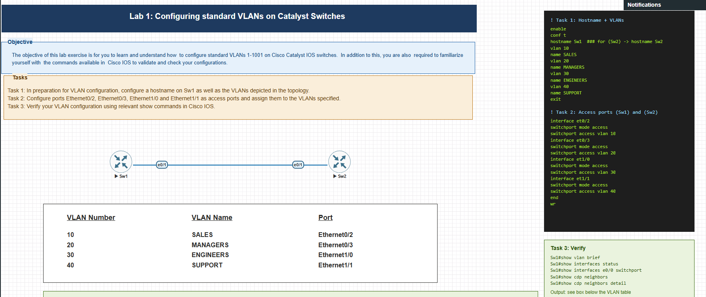
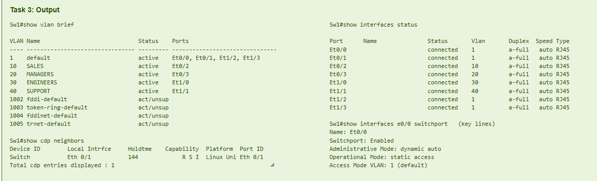

# Lab 001 – Configuring Standard VLANs on Catalyst Switches

| Item | Value |
|------|-------|
| Topic | VLANs, access ports |
| Devices | Sw1, Sw2 (Cisco IOL L2 15.2) |
| Lab file | [LAB-001-Configuring_Standard_VLANs_on_Catalyst_Switches.unl](LAB-001-Configuring_Standard_VLANs_on_Catalyst_Switches.unl) |
| Difficulty | Beginner |



---

## Objective

Create normal-range VLANs on a Catalyst switch, put access ports into those VLANs, and confirm the result with IOS show commands.

## VLAN plan

| VLAN | Name | Port (EVE-NG) |
|------|------|---------------|
| 10 | SALES | Ethernet0/2 |
| 20 | MANAGERS | Ethernet0/3 |
| 30 | ENGINEERS | Ethernet1/0 |
| 40 | SUPPORT | Ethernet1/1 |

## Tasks

1. Set the hostnames (Sw1, Sw2) and create the four VLANs from the VLAN plan.
2. Make Ethernet0/2, Ethernet0/3, Ethernet1/0 and Ethernet1/1 access ports in their VLANs.
3. Check your work with show commands.

---

<details>
<summary><b>Solution (try first, then open)</b></summary>

### Task 1 – Hostname and VLANs

```
enable
conf t
hostname Sw1
! on Sw2: hostname Sw2
vlan 10
 name SALES
vlan 20
 name MANAGERS
vlan 30
 name ENGINEERS
vlan 40
 name SUPPORT
exit
```

### Task 2 – Access ports

```
interface et0/2
 switchport mode access
 switchport access vlan 10
interface et0/3
 switchport mode access
 switchport access vlan 20
interface et1/0
 switchport mode access
 switchport access vlan 30
interface et1/1
 switchport mode access
 switchport access vlan 40
end
wr
! repeat the same on Sw2
```

### Task 3 – Verify

```
show vlan brief
show interfaces status
show interfaces e0/2 switchport
show cdp neighbors
```

</details>

---

## Output

```
Sw1#show vlan brief

VLAN Name                             Status    Ports
---- -------------------------------- --------- -------------------------------
1    default                          active    Et0/0, Et0/1, Et1/2, Et1/3
10   SALES                            active    Et0/2
20   MANAGERS                         active    Et0/3
30   ENGINEERS                        active    Et1/0
40   SUPPORT                          active    Et1/1
1002 fddi-default                     act/unsup
1003 token-ring-default               act/unsup
1004 fddinet-default                  act/unsup
1005 trnet-default                    act/unsup
```

```
Sw1#show interfaces status

Port      Name               Status       Vlan       Duplex  Speed Type
Et0/0                        connected    1          a-full   auto RJ45
Et0/1                        connected    1          a-full   auto RJ45
Et0/2                        connected    10         a-full   auto RJ45
Et0/3                        connected    20         a-full   auto RJ45
Et1/0                        connected    30         a-full   auto RJ45
Et1/1                        connected    40         a-full   auto RJ45
Et1/2                        connected    1          a-full   auto RJ45
Et1/3                        connected    1          a-full   auto RJ45
```



---

## Key points

- Each VLAN is a separate broadcast domain.
- VLAN 1 is the default, so every port you do not assign stays in VLAN 1.
- VLANs 1002–1005 are reserved and cannot be deleted.
- Always set `switchport mode access`. The default `dynamic auto` mode can turn a port into a trunk.

## Common mistakes

| Mistake | Result | How to check |
|---------|--------|--------------|
| Forgot `switchport mode access` | Port stays dynamic | `show interfaces e0/2 switchport` |
| Forgot `wr` | Config lost after reload | `show startup-config` |
| Wrong port assigned | Device in wrong VLAN | `show interfaces status` |
| VLAN name typo | Name does not match plan | `show vlan brief` |

---

_Scenario based on "101 Labs for the Cisco CCNA Exam" (Paul Browning & Farai Tafa). EVE-NG lab, solution and outputs by Raman Kumar Shakya._
