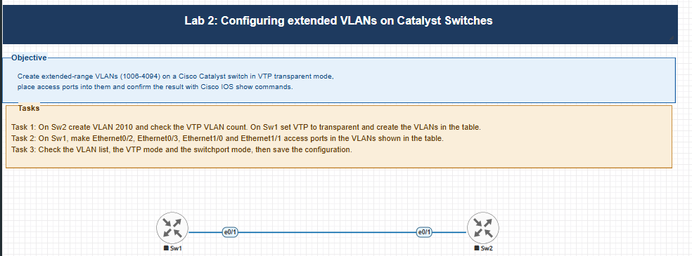
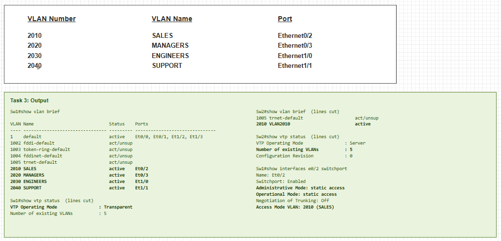
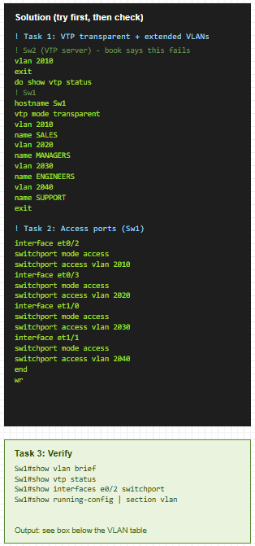

# Lab 002 – Configuring Extended VLANs on Catalyst Switches

| Item | Value |
|------|-------|
| Topic | Extended-range VLANs, VTP transparent mode, access ports |
| Devices | Sw1, Sw2 (Cisco IOL L2 15.2) |
| Lab file | [LAB-002-Configuring_Extended_VLANs_on_Catalyst_Switches.unl](LAB-002-Configuring_Extended_VLANs_on_Catalyst_Switches.unl) |
| Difficulty | Beginner |



---

## Objective

Create extended-range VLANs (1006–4094) on a Catalyst switch in VTP transparent mode, put access ports into them and confirm the result with IOS show commands. On the way, test what the book says about VTP server mode.

## VLAN plan

| VLAN | Name | Port (EVE-NG) |
|------|------|---------------|
| 2010 | SALES | Ethernet0/2 |
| 2020 | MANAGERS | Ethernet0/3 |
| 2030 | ENGINEERS | Ethernet1/0 |
| 2040 | SUPPORT | Ethernet1/1 |

## Tasks

1. On Sw2, which is still in the default VTP server mode, create VLAN 2010 and check the VTP VLAN count. On Sw1, set the hostname, change VTP to transparent mode and create the four VLANs from the VLAN plan.
2. On Sw1, make Ethernet0/2, Ethernet0/3, Ethernet1/0 and Ethernet1/1 access ports in their VLANs.
3. Check the VLAN list, the VTP mode and the switchport mode, then save the configuration.

---

<details>
<summary><b>Solution (try first, then open)</b></summary>

### Task 1: VTP transparent and extended VLANs

```
! Sw2 (still VTP server)
enable
conf t
hostname Sw2
vlan 2010
exit
do show vlan brief
do show vtp status
```

```
! Sw1
enable
conf t
hostname Sw1
vtp mode transparent
vlan 2010
 name SALES
vlan 2020
 name MANAGERS
vlan 2030
 name ENGINEERS
vlan 2040
 name SUPPORT
exit
```

### Task 2: Access ports

```
interface et0/2
 switchport mode access
 switchport access vlan 2010
interface et0/3
 switchport mode access
 switchport access vlan 2020
interface et1/0
 switchport mode access
 switchport access vlan 2030
interface et1/1
 switchport mode access
 switchport access vlan 2040
end
wr
```

### Task 3: Verify

```
show vlan brief
show vtp status
show interfaces e0/2 switchport
show running-config | section vlan
```

</details>

---

## Book vs real device

The book says a switch in VTP server mode rejects VLAN 2010 with `Extended VLANs not allowed in VTP SERVER mode`. That is the behaviour of older IOS releases. **On IOL 15.2 the VLAN was created**, but VTP ignored it:

```
Sw2#show vlan brief
...
1005 trnet-default                    act/unsup
2010 VLAN2010                         active

Sw2#show vtp status
...
VTP Operating Mode                : Server
Maximum VLANs supported locally   : 1005
Number of existing VLANs          : 5
Configuration Revision            : 0
```

VLAN 2010 exists on the switch, but `Number of existing VLANs` is still 5 and the revision is still 0. VTP version 1 does not know about the VLAN, so it will never be advertised to other switches. That is why extended VLANs are built in transparent mode (or with VTP version 3).

## Output (Sw1)

```
Sw1#show vlan brief

VLAN Name                             Status    Ports
---- -------------------------------- --------- -------------------------------
1    default                          active    Et0/0, Et0/1, Et1/2, Et1/3
1002 fddi-default                     act/unsup
1003 token-ring-default               act/unsup
1004 fddinet-default                  act/unsup
1005 trnet-default                    act/unsup
2010 SALES                            active    Et0/2
2020 MANAGERS                         active    Et0/3
2030 ENGINEERS                        active    Et1/0
2040 SUPPORT                          active    Et1/1
```

```
Sw1#show vtp status
VTP Version capable             : 1 to 3
VTP version running             : 1
VTP Domain Name                 :
VTP Pruning Mode                : Disabled
VTP Traps Generation            : Disabled
Device ID                       : aabb.cc80.1000
Configuration last modified by 0.0.0.0 at 0-0-00 00:00:00

Feature VLAN:
--------------
VTP Operating Mode                : Transparent
Maximum VLANs supported locally   : 1005
Number of existing VLANs          : 5
Configuration Revision            : 0
```

```
Sw1#show interfaces e0/2 switchport
Name: Et0/2
Switchport: Enabled
Administrative Mode: static access
Operational Mode: static access
Administrative Trunking Encapsulation: negotiate
Operational Trunking Encapsulation: native
Negotiation of Trunking: Off
Access Mode VLAN: 2010 (SALES)
Trunking Native Mode VLAN: 1 (default)
```

```
Sw1#show running-config | section vlan
vlan 2010
 name SALES
vlan 2020
 name MANAGERS
vlan 2030
 name ENGINEERS
vlan 2040
 name SUPPORT
 switchport access vlan 2010
 switchport access vlan 2020
 switchport access vlan 2030
 switchport access vlan 2040
```





---

## Key points

- Normal range is VLAN 1–1005. Extended range is VLAN 1006–4094.
- VTP version 1 and 2 only advertise VLANs 1–1005. An extended VLAN is never sent to other switches, even if the switch lets you create it in server mode.
- Build extended VLANs in `vtp mode transparent` (or VTP version 3).
- In transparent mode the VLANs appear in the running-config. Save with `wr`.
- Extended VLANs appear at the bottom of `show vlan brief`, after VLANs 1002–1005.

## Common mistakes

| Mistake | Result | How to check |
|---------|--------|--------------|
| Expecting VTP v1/v2 to sync VLAN 2010 | The VLAN never reaches other switches | `show vtp status` (VLAN count stays the same) |
| Forgot `wr` | VLANs gone after reload | `show startup-config \| section vlan` |
| Typed VLAN 4095 or 4096 | Invalid, the maximum is 4094 | `show vlan brief` |
| VLAN name typo | Wrong name in the VLAN list | `show vlan brief`, then `vlan 2020` / `name MANAGERS` |

---

_Scenario based on "101 Labs for the Cisco CCNA Exam" (Paul Browning & Farai Tafa). EVE-NG lab, solution and outputs by Raman Kumar Shakya._
