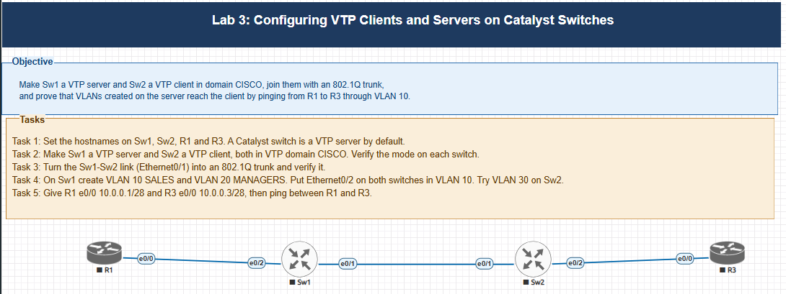
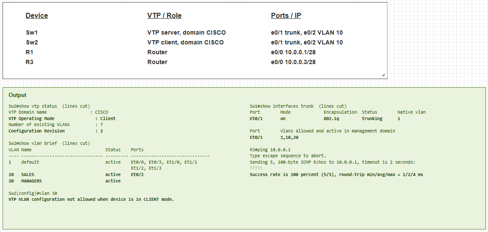
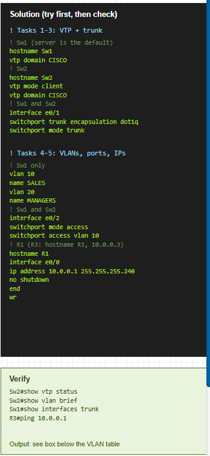

# Lab 003 – Configuring VTP Clients and Servers on Catalyst Switches

| Item | Value |
|------|-------|
| Topic | VTP server and client, VTP domain, 802.1Q trunk, access ports |
| Devices | Sw1, Sw2 (Cisco IOL L2 15.2), R1, R3 (Cisco IOL L3 15.4) |
| Lab file | [LAB-003-Configuring_VTP_Clients_and_Servers_on_Catalyst_Switches.unl](LAB-003-Configuring_VTP_Clients_and_Servers_on_Catalyst_Switches.unl) |
| Difficulty | Beginner |



---

## Objective

Make Sw1 a VTP server and Sw2 a VTP client in domain CISCO, join them with an 802.1Q trunk, and prove that VLANs created on the server reach the client by pinging from R1 to R3 through VLAN 10.

## Topology

```
R1 e0/0 ── e0/2 Sw1 e0/1 ══ trunk ══ e0/1 Sw2 e0/2 ── e0/0 R3
10.0.0.1/28   VTP server               VTP client      10.0.0.3/28
```

| Device | VTP / Role | Ports / IP |
|--------|-----------|------------|
| Sw1 | VTP server, domain CISCO | e0/1 trunk, e0/2 VLAN 10 |
| Sw2 | VTP client, domain CISCO | e0/1 trunk, e0/2 VLAN 10 |
| R1 | Router | e0/0 10.0.0.1/28 |
| R3 | Router | e0/0 10.0.0.3/28 |

## Tasks

1. Set the hostnames on Sw1, Sw2, R1 and R3. A Catalyst switch is a VTP server by default.
2. Make Sw1 a VTP server and Sw2 a VTP client, both in VTP domain CISCO. Verify the mode on each switch.
3. Turn the Sw1–Sw2 link (Ethernet0/1) into an 802.1Q trunk and verify it.
4. On Sw1, create VLAN 10 SALES and VLAN 20 MANAGERS. Put Ethernet0/2 on both switches in VLAN 10 as an access port. Then try to create VLAN 30 on Sw2.
5. Give R1 e0/0 the address 10.0.0.1/28 and R3 e0/0 the address 10.0.0.3/28, then ping between R1 and R3.

---

<details>
<summary><b>Solution (try first, then open)</b></summary>

### Tasks 1 and 2: Hostnames and VTP

```
! Sw1 (VTP server is the default, only the domain is needed)
enable
conf t
hostname Sw1
vtp domain CISCO
```

```
! Sw2
enable
conf t
hostname Sw2
vtp mode client
vtp domain CISCO
```

### Task 3: 802.1Q trunk (Sw1 and Sw2)

```
interface e0/1
 switchport trunk encapsulation dot1q
 switchport mode trunk
```

### Task 4: VLANs and access ports

```
! Sw1 only
vlan 10
 name SALES
vlan 20
 name MANAGERS
```

```
! Sw1 and Sw2
interface e0/2
 switchport mode access
 switchport access vlan 10
end
wr
```

```
! Sw2: try to create a VLAN on the client
conf t
vlan 30
```

### Task 5: Router IPs and ping

```
! R1 (on R3: hostname R3, ip address 10.0.0.3)
enable
conf t
hostname R1
interface e0/0
 ip address 10.0.0.1 255.255.255.240
 no shutdown
end
wr
ping 10.0.0.3
```

### Verify

```
show vtp status
show vlan brief
show interfaces trunk
ping 10.0.0.1
```

</details>

---

## Book vs real device

The book says Cisco switches use 802.1Q by default, so `switchport mode trunk` is enough. That is true on dot1q-only switches such as the 2960. IOL (like the 3560) supports both ISL and 802.1Q, so it rejects `switchport mode trunk` until you choose the encapsulation:

```
Command rejected: An interface whose trunk encapsulation is "Auto" can not be configured to "trunk" mode.
```

Fix: `switchport trunk encapsulation dot1q` first, then `switchport mode trunk`.

## Bonus: the client learned the domain by itself

Sw2 was given `vtp mode client` but no domain yet. When the trunk came up, it took the domain name from the first VTP advertisement it received:

```
Sw2(config)#vtp domain CISCO
Domain name already set to CISCO.
```

A switch with a NULL (empty) domain adopts the domain of the first VTP summary it hears on a trunk. Handy in a lab, risky in production: a new switch can join a domain you did not plan.

## Output

```
Sw2#show vtp status
VTP Version capable             : 1 to 3
VTP version running             : 1
VTP Domain Name                 : CISCO
VTP Pruning Mode                : Disabled
VTP Traps Generation            : Disabled
Device ID                       : aabb.cc80.2000
Configuration last modified by 0.0.0.0 at 11-19-26 10:10:47

Feature VLAN:
--------------
VTP Operating Mode                : Client
Maximum VLANs supported locally   : 1005
Number of existing VLANs          : 7
Configuration Revision            : 2
```

```
Sw2#show vlan brief

VLAN Name                             Status    Ports
---- -------------------------------- --------- -------------------------------
1    default                          active    Et0/0, Et0/3, Et1/0, Et1/1
                                                Et1/2, Et1/3
10   SALES                            active    Et0/2
20   MANAGERS                         active
1002 fddi-default                     act/unsup
1003 token-ring-default               act/unsup
1004 fddinet-default                  act/unsup
1005 trnet-default                    act/unsup
```

```
Sw2(config)#vlan 30
VTP VLAN configuration not allowed when device is in CLIENT mode.
```

```
Sw1#show interfaces trunk

Port        Mode             Encapsulation  Status        Native vlan
Et0/1       on               802.1q         trunking      1

Port        Vlans allowed on trunk
Et0/1       1-4094

Port        Vlans allowed and active in management domain
Et0/1       1,10,20

Port        Vlans in spanning tree forwarding state and not pruned
Et0/1       1,10,20
```

```
R1#ping 10.0.0.3
Type escape sequence to abort.
Sending 5, 100-byte ICMP Echos to 10.0.0.3, timeout is 2 seconds:
.!!!!
Success rate is 80 percent (4/5), round-trip min/avg/max = 3/4/8 ms
```

```
R3#ping 10.0.0.1
Type escape sequence to abort.
Sending 5, 100-byte ICMP Echos to 10.0.0.1, timeout is 2 seconds:
!!!!!
Success rate is 100 percent (5/5), round-trip min/avg/max = 1/2/4 ms
```

The first ping from R1 is lost while it waits for the ARP reply. By the time R3 pings back, both ARP entries exist, so all five succeed.





---

## Key points

- VLANs are created on the VTP server. Clients learn them over a trunk and store them.
- Server and client must use the same VTP domain name. It is case-sensitive.
- The switch with the higher configuration revision wins. Reset the revision before adding a used switch to a live domain.
- A VTP client cannot create, change or delete VLANs.
- On switches that know ISL and 802.1Q, set `switchport trunk encapsulation dot1q` before `switchport mode trunk`.

## Common mistakes

| Mistake | Result | How to check |
|---------|--------|--------------|
| VTP domain name mismatch (`CISCO` vs `cisco`) | Client learns no VLANs | `show vtp status` |
| No `switchport trunk encapsulation dot1q` | `switchport mode trunk` is rejected | `show interfaces trunk` |
| Creating VLANs on the client | `not allowed when device is in CLIENT mode` | `show vtp status` |
| Access port set on one switch only | R1 and R3 end up in different VLANs, ping fails | `show vlan brief` on both switches |
| Wrong mask (`/29` instead of `/28`) | Works here by luck, but does not match the plan | `show ip interface brief`, `show run interface e0/0` |

---

_Scenario based on "101 Labs for the Cisco CCNA Exam" (Paul Browning & Farai Tafa). EVE-NG lab, solution and outputs by Raman Kumar Shakya._
